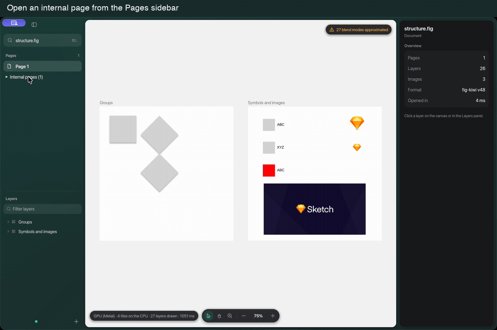

# Internal pages demo

Recorded from the native app using the public `tests/fixtures/structure.fig` fixture,
licensed under MIT from fig2sketch. Its internal page is empty, so opening it shows an
empty canvas. The recording contains only the app window and public fixture content.

The demo shows mouse navigation. Headless UI tests also cover keyboard activation.
